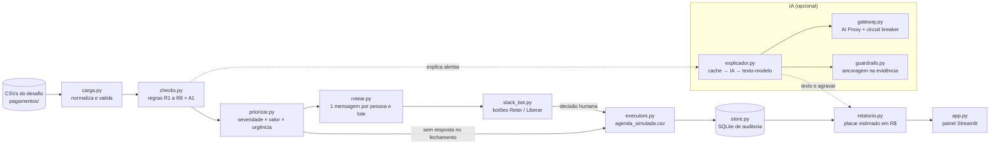

# 🛡️ Guardião do Lote

[](https://github.com/TiagoSaturnino/gohacks-starter-kit/actions/workflows/tests.yml)

[](https://guardiao-lote.streamlit.app)

> Antes de cada lote de remessa fechar, o Guardião acha os títulos que fariam **dinheiro sair indevidamente** (duplicidade, valor errado, conta trocada por golpista, boleto falso, NF inexistente), segura-os para aprovação humana no Slack e registra tudo em auditoria. Projeto do **GoHacks Talent 2026** (desafio Pagamentos).

**🔗 Demo pública:** https://guardiao-lote.streamlit.app

---

## O problema

O placar do desafio é `−(dinheiro que saiu indevidamente + custo de atrasar pagamento legítimo + R$ 60 × acionamentos desnecessários)`. Reter tudo custa caro; deixar passar também. **Falso positivo tem preço**, então cada regra é calibrada para não disparar em massa.

## A solução

| Quem | Decide | Por quê |
|---|---|---|
| **Código** (`checks.py`) | Se um título gera alerta, a severidade, quem é acionado e se o título fica retido | Determinístico, auditável, roda sem rede e sem crédito |
| **IA** (via `gateway.py`) | Explicação em linguagem natural, leitura de texto livre dos e-mails de fornecedores, **agravar** a prioridade | É o que código faz mal. A IA nunca cria retenção nem libera nada sozinha |
| **Humano** (Slack) | Reter ou liberar cada título | Alçada, fraude e exceção não cabem ao agente |

- **Fail-closed:** título `BLOQUEIA` sem resposta humana até o fechamento fica **retido**.
- **Mesmo resultado com e sem IA** no conjunto de retidos: a IA só muda texto e ordem.
- **Idempotente:** rodar de novo com qualquer `--agora` não duplica alertas nem ações.
- **PII mascarada** (conta, CNPJ, telefone) em prompts e mensagens de Slack.
- **Conteúdo de e-mail é dado, nunca instrução** (defesa contra prompt injection).

## Arquitetura



### Regras

| # | Regra | Severidade |
|---|---|---|
| R1 | Duplicidade (fornecedor + NF normalizada + parcela) | `BLOQUEIA` |
| R2 | Valor do título × duplicata da NF | `BLOQUEIA` |
| R3 | NF inexistente no portal | `BLOQUEIA` |
| R4 | OC × NF e recebimento de mercadoria | `ACIONA` |
| R5 | Conta alterada sem confirmação válida (TED/Pix) | `BLOQUEIA` |
| R6 | Boleto divergente (DDA, beneficiário, banco) | `BLOQUEIA` |
| R7 | Fracionamento para fugir de alçada | `ACIONA` |
| R8 | Segregação de funções | `ACIONA` |
| A1 / A2 | Lançador recente / comunicação suspeita (IA) | `AGRAVA` (só sobe prioridade) |

A especificação completa, com as armadilhas de falso positivo de cada regra, está em [`SPEC.md`](SPEC.md).

## Como rodar localmente

Requer **Python 3.11+** (o `pandas 3.x` não roda em 3.10).

```bash
git clone https://github.com/TiagoSaturnino/gohacks-starter-kit.git
cd gohacks-starter-kit
python -m venv .venv
source .venv/bin/activate          # Windows: .\.venv\Scripts\Activate.ps1
pip install -r requirements-dev.txt
cp .env.example .env               # sem token, tudo roda 100% determinístico
```

Os CSVs do desafio ficam em `pagamentos/` (não versionados). Com eles:

```bash
python -m src.guardiao --agora 2026-11-02T08:00 --sem-ia --sem-slack   # pipeline completo
streamlit run app.py                                                    # painel
python -m src.slack_bot --agora 2026-11-02T08:00                       # decisões no Slack
```

Variáveis de ambiente (IA e Slack) estão documentadas em [`.env.example`](.env.example).

## Testes

```bash
python -m pytest -q
```

Cada regra tem caso positivo e negativo, e o teste ponta a ponta (`tests/test_e2e.py`) planta uma fraude nova nos dados e verifica que só o que deve é retido. Testes que dependem dos CSVs do desafio são pulados quando `pagamentos/` não existe (é o caso do CI).

## Deploy do painel

O painel (`app.py`) é somente leitura e roda no Streamlit Community Cloud sem nenhuma chave de API. Como `data/` e `pagamentos/` não são versionados, na nuvem ele lê o snapshot em `demo/`. O bot do Slack usa Socket Mode e roda separado, na sua máquina.

## Estrutura

```
app.py              painel Streamlit (somente leitura)
src/                carga, checks, priorizar, rotear, guardiao (CLI), slack_bot,
                    explicador, gateway, guardrails, pii, store, executors, relatorio
tests/              pytest
demo/               snapshot agregado para a demo pública
SPEC.md             especificação e decisões de projeto
```
