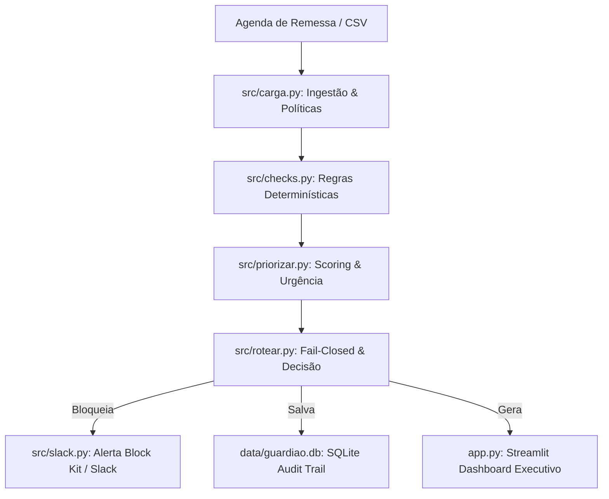

<<<<<<< HEAD
# 🛡️ Guardião de Pagamentos — AI Governance & Resilient Batch Engine


> Engine autônoma em Python voltada para governança financeira, detecção de riscos em lotes de remessa bancária, priorização por horário de fechamento e workflows de *Human-in-the-Loop* via Slack.

---

## 💡 O Problema & A Solução

Processar lotes de pagamento de forma puramente manual ou sem validações estritas expõe a empresa a duplicidades, fraudes e falhas operacionais críticas ("abrir a torneira" de dinheiro por erro). 

O **Guardião de Pagamentos** resolve esse gargalo através de 4 pilares:
1. **Regras Determinísticas Offline:** Validação estrita de regras de negócio (R1 a R8 + A1) para identificar inconsistências e duplicidades de títulos.
2. **Severidade Granular & Fail-Closed:** Apenas severidades do tipo `BLOQUEIA` retêm pagamentos. Em caso de falha de sistema, o motor adota *fail-closed* por segurança.
3. **Priorização por Urgência & Impacto:** Classifica demandas cruzando o horário limite de fechamento do lote com o valor financeiro consolidado em R\$.
4. **Agente com Humano no Circuito (*Human-in-the-Loop*):** Disparo de alertas interativos estruturados no Slack via Block Kit para aprovação gerencial.

---

## 📐 Arquitetura do Sistema


🛠️ Funcionalidades PrincipaisMóduloResponsabilidade Técnicasrc/checks.pyAplicação de regras estáticas de conformidade e detecção de riscos.src/priorizar.pyCálculo de score considerando o horário de fechamento e valor financeiro (R$).src/rotear.pyLógica de decisão baseada em severidade (BLOQUEIA vs ACIONA) com fail-closed.src/slack.pyIntegração via Webhook com Slack (Block Kit e botões interativos).src/guardiao.pyOrquestrador CLI central e consolidação de relatórios executivos em JSON.app.pyInterface interativa em Streamlit para auditoria executiva e filtros de lotes.🚀 Como Executar o Projeto LocalmentePré-requisitosPython 3.10+GitPasso a PassoClonar o repositório:Bashgit clone [https://github.com/TiagoSaturnino/gohacks-starter-kit.git](https://github.com/TiagoSaturnino/gohacks-starter-kit.git)
cd gohacks-starter-kit
Criar e ativar o ambiente virtual:Bashpython -m venv .venv
# Windows (PowerShell):
.\.venv\Scripts\Activate.ps1
# Linux/Mac:
source .venv/bin/activate
Instalar dependências:Bashpip install -r requirements.txt
Configurar variáveis de ambiente (Opcional - Slack):
Crie um arquivo .env na raiz do projeto:Snippet de códigoSLACK_WEBHOOK_URL="sua_url_do_webhook_aqui"
Executar a suíte de testes:Bashpytest
Rodar o pipeline do Guardião (Modo CLI):Bashpython -m src.guardiao --agora 2026-11-02T08:00 --sem-ia --sem-slack
Iniciar a interface Streamlit:Bashpython -m streamlit run app.py
🧪 Cobertura de TestesO projeto conta com suíte de testes unitários e de integração automatizados via pytest:Bashroot@career-ops:# pytest -v
========================== test session starts ==========================
tests/test_checks.py ........................................... [PASS]
tests/test_e2e.py .............................................. [PASS]
tests/test_gateway.py .......................................... [PASS]
========================== 129 passed in 14.91s ==========================
=======
# Guardião do Lote — GoHacks Talent 2026 (desafio Pagamentos)

Antes de cada lote de remessa fechar, acha os títulos que fariam dinheiro sair
indevidamente (duplicidade, valor errado, conta trocada por golpista, boleto falso),
pede decisão humana no Slack e registra tudo em auditoria. Construído sobre o meu
kit-base (Pydantic v2, aprovação humana em código, PII mascarada, fila manual
fail-safe, auditoria SQLite). Especificação completa: `SPEC.md`.

## Quem decide o quê

| Quem | Decide | Onde |
|---|---|---|
| Código | se o título gera alerta, severidade, quem acionar, se fica retido | `src/checks.py` (itens 2–3 do SPEC) |
| IA, via gateway | só a explicação e o sinal "agravar"; o schema nem tem campo para reter/liberar | `src/explicador.py`, `src/schemas.py` |
| Humano (Slack) | reter ou liberar | item 6 do SPEC |
| Agente | executa a decisão na agenda simulada e audita | `src/executors.py`, `src/store.py` |

## Garantias

| Garantia | Como | Onde |
|---|---|---|
| Uma porta só para IA | Todo modelo passa pelo AI Proxy do evento (formato OpenAI): `chat_json` para texto, Jev para decisão tipada barata. DeepSeek bloqueado | `src/gateway.py` |
| Custo visível | Toda chamada registra tokens (chat) ou US$ estimado (Jev) em `usos_ia` e no log `[custo]`. Chat não tem preço por chamada: não inventamos | `src/gateway.py`, `src/store.py` |
| IA não inventa | Saída validada por Pydantic + ancoragem: IDs citados precisam estar na evidência. 1 reparo, depois texto-modelo | `src/guardrails.py` |
| Plano B sem crédito | Cache em disco → gateway → texto-modelo. Breaker abre após 3 falhas. Retenções não mudam sem IA | `src/explicador.py`, `src/resilience.py` |
| Dados bancários não saem crus | Linha digitável, chave de acesso, conta, destino e pix mascarados no prompt; máscara parcial no Slack | `src/pii.py` |
| Re-execução segura | Alertas e acionamentos idempotentes; vale a última decisão por título e lote; dois relógios (real e simulado) | `src/store.py` |
| Original intocado | Escrita simulada em `data/agenda_simulada.csv` | `src/executors.py` |

## Rodar (Windows / PowerShell)

```powershell
py -m venv .venv
.\.venv\Scripts\Activate.ps1
pip install -r requirements-dev.txt
Copy-Item .env.example .env      # coloque o AI_PROXY_API_KEY e USE_IA=True para usar IA
pytest
python -m src.gateway --ping --jev   # teste de fumaça do gateway (mostra a linha [custo])
```

Os CSVs do desafio ficam em `./pagamentos` (fora do git).
>>>>>>> 0befe969dce2620aeabb47a698aea167f6cf1d50
