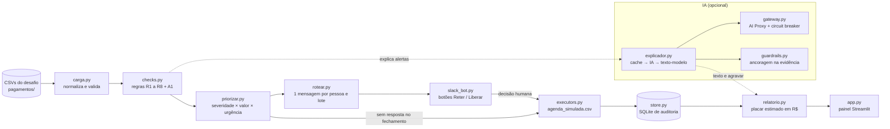

$readme = @'
# 🛡️ Guardião do Lote

[](https://github.com/TiagoSaturnino/gohacks-starter-kit/actions/workflows/tests.yml)

[](https://guardiao-lote.streamlit.app)

> Antes de cada lote de remessa fechar, o Guardião identifica os títulos que fariam **dinheiro sair indevidamente** (duplicidade, valor divergente, conta alterada sem confirmação, boleto suspeito, NF inexistente), retém os casos críticos para aprovação humana no Slack e registra toda a trilha em auditoria. Projeto desenvolvido para o **GoHacks Talent 2026** (desafio Pagamentos).

**🔗 Painel Executivo ao vivo:** https://guardiao-lote.streamlit.app

---

## 💡 O Problema & A Solução

Processar lotes de pagamento sem travas automatizadas expõe o caixa a duplicidades e fraudes; por outro lado, bloquear tudo gera custo operacional e atraso com fornecedores legítimos. O **Guardião do Lote** equilibra essa decisão separando claramente o que é determinístico, o que é IA e o que exige aprovação humana:

| Quem | Decide | Onde | Por quê |
|---|---|---|---|
| **Código** | Se gera alerta, severidade, quem acionar e retenção | `src/checks.py` | Determinístico, auditável e funciona 100% offline |
| **IA (Gateway)** | Explicação executiva em linguagem natural e sinal de agravamento | `src/explicador.py`, `src/schemas.py` | Resume evidências e lê e-mails; o schema não permite reter nem liberar sozinho |
| **Humano (Slack)** | Reter ou liberar cada título bloqueado | `src/slack_bot.py` | Alçada, exceção e fraude exigem decisão humana (*Human-in-the-Loop*) |
| **Executor** | Grava decisão na agenda simulada e audita | `src/executors.py`, `src/store.py` | Preserva a base original intacta e mantém histórico completo |

### Garantias de Engenharia & Segurança

- **Fail-closed:** títulos com severidade `BLOQUEIA` sem resposta humana até o fechamento permanecem **retidos**.
- **Resiliência sem crédito/rede:** fluxo em cascata (`cache em disco` $\rightarrow$ `AI Proxy` $\rightarrow$ `texto-modelo` determinístico) com *Circuit Breaker* (`src/resilience.py`). O conjunto de títulos retidos não muda com ou sem IA.
- **Anti-alucinação & Anti-injection:** saídas da IA validadas por Pydantic v2 + ancoragem estrita de identificadores (`src/guardrails.py`). Comunicações de fornecedores são tratadas exclusivamente como dados.
- **Privacidade (LGPD):** CPF, CNPJ, telefone, conta bancária, linha digitável e chave Pix são mascarados antes de qualquer chamada externa ou envio ao Slack (`src/pii.py`).
- **Idempotência:** reexecutar o pipeline não duplica alertas, acionamentos nem decisões (`src/store.py`).

---

## 📐 Arquitetura do Sistema


Regras Implementadas#RegraSeveridadeR1Duplicidade (fornecedor + NF normalizada + parcela)BLOQUEIAR2Valor do título × duplicata da NF (com carência de dia útil)BLOQUEIAR3Nota Fiscal inexistente no portalBLOQUEIAR4Ordem de Compra × NF e recebimento de mercadoriaACIONAR5Conta alterada sem confirmação válida por ligação (TED/Pix)BLOQUEIAR6Boleto divergente (DDA, beneficiário, banco histórico)BLOQUEIAR7Fracionamento para fugir de alçadaACIONAR8Segregação de funçõesACIONAA1 / A2Lançador recente / comunicação suspeita (IA)AGRAVA (sobe prioridade)A especificação completa e as decisões de calibração estão documentadas em SPEC.md.🚀 Como Executar LocalmenteRequer Python 3.11+ (pandas 3.x exige versão $\ge$ 3.11).PowerShellgit clone [https://github.com/TiagoSaturnino/gohacks-starter-kit.git](https://github.com/TiagoSaturnino/gohacks-starter-kit.git)
cd gohacks-starter-kit
py -3.11 -m venv .venv
.\.venv\Scripts\Activate.ps1
pip install -r requirements-dev.txt
Copy-Item .env.example .env
Comandos PrincipaisPowerShell# 1. Rodar a suíte de testes automatizados (unitários e ponta a ponta)
python -m pytest -q

# 2. Executar o motor do Guardião (com os CSVs em pagamentos/)
python -m src.guardiao --agora 2026-11-02T08:00 --sem-ia --sem-slack

# 3. Abrir o painel executivo localmente (usa demo/ se data/ não existir)
streamlit run app.py

# 4. Iniciar o bot interativo do Slack em Socket Mode
python -m src.slack_bot --agora 2026-11-02T08:00
📁 Estrutura do ProjetoPlaintextapp.py              Painel executivo em Streamlit (modo ao vivo e modo demo)
src/                Motor: carga, checks, priorizar, rotear, guardiao, slack_bot,
                    explicador, gateway, guardrails, pii, store, executors, relatorio
tests/              Suíte pytest (139+ testes unitários e e2e)
demo/               Snapshot agregado utilizado no deploy público do Streamlit
SPEC.md             Especificação de regras e arquitetura
'@
[System.IO.File]::WriteAllText("$PWD\README.md", $readme)
Write-Host "README.md atualizado com sucesso!"
### 2. Subir e corrigir a branch `main` no GitHub
Para que quem abrir o link principal do seu GitHub (`[github.com/TiagoSaturnino/gohacks-starter-kit](https://github.com/TiagoSaturnino/gohacks-starter-kit)`) veja esse código limpo e não aquela `main` antiga com conflito, rode:

```powershell
git checkout feat/explicador-markdown
git add README.md
git commit -m "docs: limpa README definitivo com link da demo e arquitetura"
git push origin feat/explicador-markdown

# Atualiza a branch main remota com a versão limpa e passa nos testes do GitHub Actions
git push origin feat/explicador-markdown:main --force
